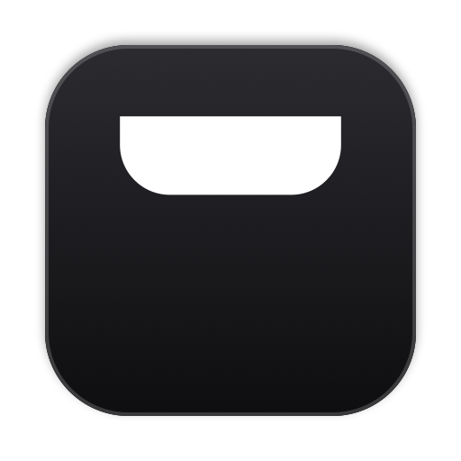

<!-- App icon: save a 256×256 PNG as docs/icon.png, then uncomment this line.

-->

# MacCove

**The notch on your Mac, put to work.**

Music, battery, meetings, downloads and more, one glance away.

<!-- Screenshot: save a wide screenshot or GIF as docs/preview.png, then uncomment this line.
  
-->

---

## Features

| | |
|---|---|
| **Now Playing** | See what's playing, skip tracks and switch AirPlay speakers. |
| **Battery** | Charging and low battery alerts, plus your mouse, keyboard and controller. |
| **Calendar & Reminders** | Your next meeting and what's due today. |
| **Downloads** | Watch files come in as they download. |
| **Shelf & Clipboard** | Drop files on the notch to keep them handy, and find things you copied. |
| **Mirror** | Check your camera before a call. |
| **Lock Screen** | Touch ID and unlock, right at the notch. |
| **Developer Tools** | Xcode builds, Terminal commands, GitHub, and Claude Code, Codex and Cursor. |

No notch? MacCove works at the top of any display.

## Install

1. Download the latest **.dmg** from [Releases](https://github.com/duclingg/MacCove/releases/latest).
2. Open it and drag **MacCove** into **Applications**.
3. Open MacCove. A short welcome walks you through setup.

> [!NOTE]
> MacCove requires **macOS 26** or later.

## Privacy

No account, no analytics, no tracking. MacCove only goes online to check for updates and for integrations you turn on, like GitHub.

## Contributing

Bug reports, ideas and pull requests are welcome.

- **Report a bug or suggest a feature:** [open an issue](https://github.com/duclingg/MacCove/issues/new).
- **Make a change:**
  1. Fork the repo and branch from `develop`.
  2. Open `MacCove.xcodeproj` in Xcode 26 and run the **MacCove** scheme.
  3. Open a pull request against `develop`, one change per pull request.

## License

MacCove is free and open source under the [GPL-3.0 License](LICENSE).

Now Playing uses [MediaRemoteAdapter](Packages/MediaRemoteAdapter) by Jonas van den Berg (BSD 3-Clause).
